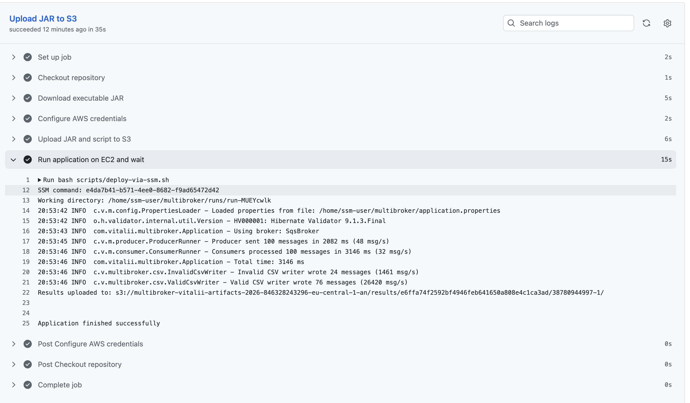
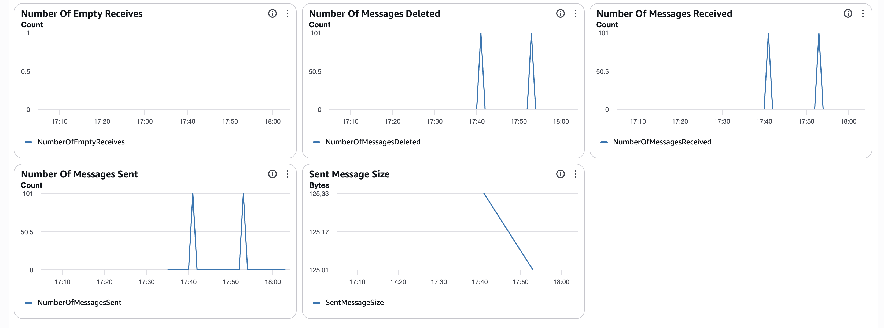

# MultiBrokerQueue

A Java 21 learning project that demonstrates message processing with
multiple message brokers, validation, CSV output, and an AWS deployment pipeline.

The application generates messages, sends them through a selected broker,
validates received messages, and writes valid and invalid results to separate CSV files.

## Supported brokers

- In-memory bounded queue
- RabbitMQ
- ActiveMQ Artemis
- Apache Kafka
- Amazon SQS FIFO

The broker is selected through `broker.type` in the application configuration.

## Processing flow

```text
MessageGenerator → Producer → MessageBroker → Consumer → Validation
                                                            ├─ valid.csv
                                                            └─ invalid.csv
```

Messages contain a name, an EDDR identifier, a count, and a creation timestamp.

Validation uses Jakarta Validation and a custom EDDR validator.

Output files:

- `valid.csv`: `name,count`
- `invalid.csv`: `name,count,errors`

Validation errors are serialized as JSON inside an escaped CSV field.

Output files are overwritten on each application run.

## Requirements

- Java 21
- Maven
- Docker with Docker Compose for local broker integration tests

Docker and AWS credentials are not required for the in-memory mode.

## Quick start

Build the executable JAR:

```bash
mvn clean verify
```

Run using the configuration bundled inside the JAR:

```bash
java -Duser.timezone=Europe/Kyiv \
  -jar target/MultiBrokerQueue-1.0.1.jar
```

The bundled configuration uses the in-memory broker.

Use the JAR filename produced by your build if the project version changes.

## External configuration

Copy `src/main/resources/application.properties` to an external file
and adjust the required settings.

Run with an explicit configuration path:

```bash
java -Duser.timezone=Europe/Kyiv \
  -jar target/MultiBrokerQueue-1.0.1.jar application.properties
```

Without a configuration argument, the application reads the classpath resource.
It does not automatically select a file from the working directory.

Important settings:

| Property | Description |
|---|---|
| `broker.type` | `inmemory`, `rabbitmq`, `activemq`, `kafka`, or `sqs` |
| `queue.name` | Queue or topic name for local brokers |
| `messages.count` | Number of generated data messages |
| `consumers.count` | Number of consumers |
| `consumers.completion.timeout.seconds` | Consumer completion wait timeout |
| `csv.valid.path` | Valid-message CSV output path |
| `csv.invalid.path` | Invalid-message CSV output path |
| `inmemory.queue.capacity` | Maximum in-memory queue size |
| `inmemory.send.timeout.seconds` | Maximum wait when the in-memory queue is full |

The configuration loader currently reads settings for all brokers.
Keep the other broker settings when creating an external configuration.

The current RabbitMQ and Artemis password property names are
`rabbitmq.passwordd` and `activemq.passwordd`.

Do not commit real credentials.

### Kafka

The number of consumers must equal `kafka.partitions.count`.

The application includes topic initialization and partition-count validation.

### Amazon SQS

The current implementation supports one FIFO queue and one consumer:

```properties
broker.type=sqs
consumers.count=1
messages.count=100

sqs.region=eu-central-1
sqs.queue.url=https://sqs.eu-central-1.amazonaws.com/<account-id>/<queue-name>.fifo
sqs.message.group.id=multibroker
```

Create the queue and grant the application the required IAM permissions
before running this mode. The application does not create the SQS queue.

On EC2, the application can obtain temporary credentials from its instance role
through the AWS SDK default credentials provider chain.
No access keys are embedded in the application.

## Local brokers

Start the brokers:

```bash
docker compose up -d
```

Select the required broker in your external configuration.

Stop the containers while preserving them:

```bash
docker compose stop
```

The Compose configuration is intended for local development,
not for deployment on a publicly accessible server.

## Tests

Run unit tests and tests that do not require external brokers:

```bash
mvn test
```

Broker integration tests are skipped unless explicitly enabled.

Start the local brokers, then run the full local test suite and package the JAR:

```bash
docker compose up -d

RUN_RABBITMQ_TESTS=true \
RUN_ARTEMIS_TESTS=true \
RUN_KAFKA_TESTS=true \
mvn clean verify
```

SQS unit tests use Mockito and do not contact AWS.
The real SQS integration was verified separately on EC2.

## GitHub Actions

The workflow runs on pull requests targeting `main`, pushes to `main`,
and manual dispatch.

The active build job:

- Sets up Java 21.
- Runs `mvn clean verify`.
- Uploads test reports.
- Uploads the executable JAR.

The default CI job does not start the external brokers,
so their integration tests are skipped.

## AWS deployment demonstration

The following pipeline was implemented and manually verified:

```text
GitHub Actions → S3 artifacts → SSM Run Command → EC2
                                                  ├─ SQS FIFO
                                                  └─ CSV results → S3
```

GitHub Actions authenticated through OIDC.
The EC2 application used an IAM instance role.

Deployment scripts are retained in `scripts/`:

- `deploy-via-ssm.sh` submits the remote command and waits for its result.
- `run-on-ec2.sh` downloads the JAR, runs it, and uploads CSV results.

A successful demonstration processed 100 data messages:
76 valid and 24 invalid. The logs identified `SqsBroker`,
and SQS metrics showed message traffic including the STOP message.

**AWS deployment is currently disabled in the workflow.
The demo infrastructure was deleted after verification.**

Re-running the deployment requires recreating the infrastructure,
IAM permissions, configuration, and GitHub repository variables:

- `AWS_ROLE_ARN`
- `AWS_REGION`
- `S3_BUCKET`
- `EC2_INSTANCE_ID`

## Scope and limitations

This is a learning project, not a production-ready messaging platform.

- One producer generates the messages.
- Consumers use STOP messages to finish processing.
- The SQS implementation currently supports one consumer.
- SQS processing must fit within its configured visibility timeout;
  automatic visibility extension is not implemented.
- CSV writes and broker acknowledgements are not atomic.
  Failures can cause duplicate processing or incomplete output.
- Exactly-once durable CSV output is not guaranteed.
- Throughput logs are diagnostic measurements, not a controlled benchmark.
  Different broker durability and acknowledgement settings affect comparisons.

### Demo screenshots

Successful deployment and application execution:



SQS message metrics from the demonstration runs:

